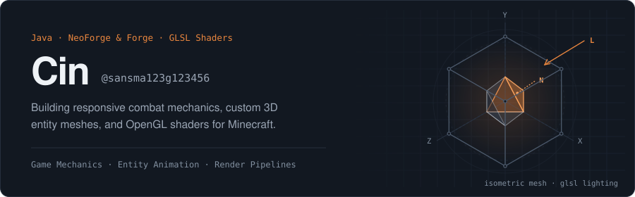
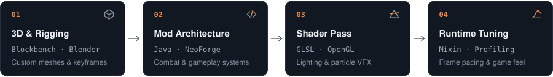

<picture>
  <source media="(prefers-color-scheme: dark)" srcset="assets/hero-dark.svg" />
  <source media="(prefers-color-scheme: light)" srcset="assets/hero-light.svg" />
  
</picture>

 

I build custom gameplay systems, entity rigs, and shader passes for Minecraft — focusing on tight combat feel, clean bytecode architecture, and stable frame pacing.

### Focus

**01. Combat & Gameplay Mechanics**  
Hit-timing, movement states, input responsiveness, and custom entity behavior built with NeoForge, Forge, and Mixin hooks.

**02. 3D Meshes & Entity Animation**  
Articulated models, keyframe sequences, and procedural particle systems authored across Blockbench and Blender.

**03. Shaders & Render Pipelines**  
GLSL shaders and OpenGL rendering techniques exploring lighting atmosphere, visual effects, and client-side optimization.

---

### Pipeline

<picture>
  <source media="(prefers-color-scheme: dark)" srcset="assets/pipeline-dark.svg" />
  <source media="(prefers-color-scheme: light)" srcset="assets/pipeline-light.svg" />
  
</picture>

---

### Toolchain

| Domain | Stack | Usage |
| :--- | :--- | :--- |
| **Core** | Java, GLSL, Python, JSON | Mod logic, vertex/fragment shaders, data & build scripts |
| **Modding** | Minecraft, NeoForge, Forge, Mixin | Gameplay hooks, custom combat mechanics, bytecode injection |
| **Graphics** | OpenGL, GLSL Shaders | Lighting passes, custom VFX, particle systems |
| **3D & Dev** | Blockbench, Blender, Git, VS Code | Entity geometry, keyframe rigs, version control |

---

<a href="https://github.com/sansma123g123456?tab=repositories">Repositories</a> · <a href="https://github.com/sansma123g123456">GitHub</a>
